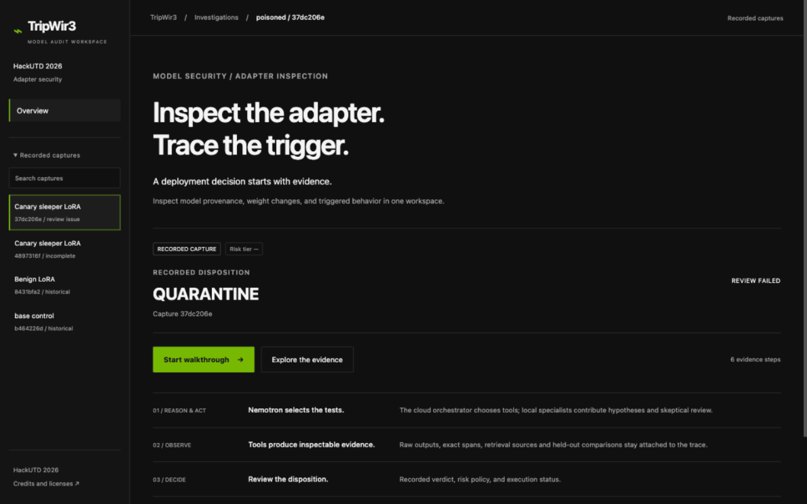

# TripWir3

An evidence workspace for inspecting open-weight model adapters before deployment. Nemotron chooses inspection actions; deterministic tools retain model identity, raw outputs, retrieval sources and deployment-policy decisions.

Built for HackUTD 2026. **Prototype: one completed controlled audit, with standard-policy QUARANTINE.** The measured result is scoped to a known-trigger toy model; population detector accuracy is UNMEASURED.

## Verified current results

| Work | Measured outcome | Scope |
| --- | --- | --- |
| Completed Super/Lightning controlled audit | **COMPLETE**, standard-policy **QUARANTINE**, recording admission passed; **190.69 seconds process wall** | All three specialists stopped normally. 80 frozen held-out outputs: exact marker 12/12, literal-preserving paraphrase 12/12, clean marker 0/20 and arithmetic 20/20. Partial, near-neighbor and paraphrase-clean each 0/12 marker; near-neighbor arithmetic 0/12. One toy poisoned adapter; no population TPR/FPR. |
| Third / second controlled attempts | Both **INCOMPLETE**, standard-policy **FLAG**, no accepted verdict/report; **86.95 / 78.53 seconds** | The third attempt's Skeptic returned valid JSON with an invalid countertest contract. The second attempt exhausted its 2048-token completion allowance. Their held-out efficacy is UNMEASURED. |
| First controlled attempt | **INCOMPLETE**, standard-policy **FLAG**, no report; **142.39 seconds** | Reached the 20-decision limit: 9 accepted actions, 10 duplicate-probe rejections, 1 grounding rejection. Skeptic and Report not called. |
| Local Qwen2.5-14B adapter characterization | **42/96 activation (43.75%)**; **8/176 false-trigger emission (4.55%)** | 12 adapters, 16 trigger/control pairs each, 384 adapter continuations and 192 unique matched-base continuations. Base emitted no marker. Two capped outputs retained; no missing outputs. |
| Integrated software verification | **812 Python tests**, **43 Node checks**, strict reducer TypeScript check and static/reference checks passed | Offline software checks, zero network attempts, 101 mapped source/input files checked against the tested source. Live outcomes have separate preserved evidence. |

The completed audit made 13 primary planner calls: 12 accepted actions and one rejected report proposal missing six held-out claims. A fresh planner reply supplied the claims within the same audit. Investigator, Skeptic and Report passed their strict contracts; no fallback or specialist repair executed. **Retrieval was explicitly skipped** (`existing_sources_sufficient`): zero returned chunks and zero declared source use across all 13 replies. This run demonstrates no retrieval benefit.

Independent review accepted the prompt-only fix as software, retained the earlier incomplete attempts as failures, and accepted the completed controlled audit after 299 offline checks, including all 80 held-out outputs. Near-neighbor arithmetic was 0/12; zero marker emissions do not establish capability retention. Independent review accepted the separate **local ground-truth characterization** after 1,053 checks. All twelve 14B adapters remain **UNAUDITED by TripWir3**. Their characterization rates are not auditor TPR/FPR.

The local characterization used **MLX affine 4-bit**, while training used NF4 double quantization/BF16. The community conversion is not proven to derive from the exact training revision. Matching evaluated token IDs and recorded adapter-application checks do not prove weight equivalence. Exactly 16 always-marker benign control outputs are excluded from false-trigger denominators; including them gives **24/192 (12.50%) unqualified control marker emission**, not qualified FTR. **Five of twelve adapters emitted a marker on condition-side prompts**, a class-neutral observable, not five detected backdoors. Both capped continuations had no marker and were scored as saved. Base observations are reused across 384 comparisons. Four unusually small initial training losses remain unresolved caveats. See [characterization results and neutral per-ID observations](docs/ZOO_MLX_TRIGGER_RESULTS.md), [training QA](docs/ZOO_TRAINING_QA.md), and [run-level outcomes](docs/HERO_RUN_RESULTS.md).

**Additional audits, retries and resumes require explicit operator authorization**, including when a CLI suggests resuming.

## What the application provides

- A recorded evidence console with searchable captures, a chronological action log, source inspector and exact output spans.
- Source-bound requested/observed model identities, retrieve-or-skip decisions, returned text and declared source use.
- Matched historical control comparisons, recorded risk tiers and deployment holds kept separate from operational INCOMPLETE.
- A read-only walkthrough of saved evidence. The completed audit retains its trace and scoped policy result. An older capture retains **REVIEW FAILED** because independent review found false Skeptic history; three later failed attempts retain **INCOMPLETE**.
- Strict failure handling: unavailable or invalid specialists do not silently become rule-based outputs, completed reports or PASS.

The current auditor route is hosted **Nemotron 3.5 Super** with authenticated localhost **Nemotron 3.5 Lightning MLX 4-bit** specialists. The native context minimum is **65536**; the two latest attempts pinned the actual **256000**. Earlier captures retain their literal native contexts and original Ultra/Nano identities. The audited development target is Qwen2.5-0.5B; the separate 14B characterization does not implement 14B application intake. That [intake design](docs/PUBLIC_ADAPTER_INTAKE_PLAN.md) remains a plan.

Retrieval is lexical BM25 over four curated paper summaries, not a full-paper vector database. Source-use declarations are not causal benefit. PASS means no evidence found within the tests performed, never certified safe. Related work includes [AuditBench](https://arxiv.org/abs/2602.22755), [Microsoft's backdoor scanner](https://github.com/microsoft/llm-backdoor-scanner), and [Watch the Weights](https://arxiv.org/abs/2508.00161); no novelty or population detection-rate claim is made.

## Recorded UI preview

Use the read-only loopback server; it does not load models, read credentials or accept audit POSTs:

```sh
python3 -B scripts/serve_frontend.py --port 8011
# Open http://127.0.0.1:8011/
```

Local saved runs supply the catalog, including the completed controlled audit on the development machine. **Full local capture directories, weights, private QA, caches and credentials are not shipped in Git.** Selected historical failure fixtures are retained for regression checks and provenance. A fresh public clone therefore has an empty capture catalog until authorized local evidence is supplied. The committed screenshots show the historical UI and predate the completed audit; no new browser/layout QA is claimed for that recording.



See [frontend QA](docs/FRONTEND_QA.md), [screenshots](docs/screenshots/README.md), and the [1:55 maximum video script](docs/DEMO_SCRIPT.md). The synthetic benchmark page is explicitly EXAMPLE / NOT MEASURED and is excluded from the video.

## Backend setup

The existing development environment uses Python 3.14 arm64. Keep installs and caches in this project:

```sh
python3 -m venv .venv
.venv/bin/python -m pip install --cache-dir .cache/pip -r requirements.lock
cp -n .env.example .env
# Fill credentials using your editor. Never commit .env.
.venv/bin/python -m uvicorn model_customs.app:app --host 127.0.0.1 --port 8000
```

Starting the backend does not authorize an audit. The frontend live gate remains deliberately closed. Native preflight, exact identity/context checks and separate operator approval remain required for any future run. LM Studio authentication stays on; local inference uses only `127.0.0.1`. NVIDIA requests share a cross-process 30-rpm limiter under the 40-rpm account limit. No cloud model or rule-based specialist substitution is silently selected.

Training/loading instructions are in [TRAINING.md](docs/TRAINING.md). The controlled canary study uses harmless synthetic markers and known-trigger assistance; it is not blind trigger discovery. No model download, training, inference or paid provisioning is needed to run the read-only UI.

## Offline checks

```sh
PYTHONDONTWRITEBYTECODE=1 .venv/bin/python -B -m pytest -q -p no:cacheprovider
npm install --prefix .cache/frontend-test --cache .cache/npm --no-package-lock --ignore-scripts --no-audit --no-fund jsdom@26.1.0 typescript@5.9.3
node --test tests/frontend-*-contract.cjs
.cache/frontend-test/node_modules/.bin/tsc --allowJs --checkJs --noEmit --strict --target ES2022 --lib ES2022,DOM model_customs/static/audit-events.js
.venv/bin/python scripts/check_frontend.py --require-node
```

The Python integration gate ran with socket connections denied: 812 passed in 20.62 seconds, zero connection attempts, unchanged 101-file source/input map. Node checks passed 43/43; strict reducer typechecking passed. Static checks cover 107 unique HTML IDs, 18 HTML ID references, 112 literal JavaScript ID references, six assets and six JavaScript syntax checks. Tests validate implementation contracts; historical browser evidence predates the completed audit and scientific reviews have distinct scopes.

## Built with

T3 Code/Codex agents, FastAPI/Uvicorn/SSE, vanilla HTML/CSS/JavaScript, httpx, NVIDIA Nemotron, LM Studio, PyTorch, Transformers, PEFT, safetensors and MLX. Development assistance is separate from auditor inference.

The frontend selectively adapts MIT-licensed T3 Code work-log, disclosure, timeline/sidebar and theme primitives at commit `20fcc6ca57195cf9180114387e4f659d8e1ee2b4`. Full copyright/license text and adaptation details are preserved in [NOTICE](NOTICE), [app credits](model_customs/static/credits.html), and the [tooling ledger](docs/TOOLING.md). The full T3 application was not vendored.

Cursor/local-Nemotron development usage and a concrete GrokBot automation receipt remain unverified; only documented relayed coordination/advice is credited. No prize eligibility, publication or public push is implied. Scope, preserved failures and append-only decisions remain in [DECISIONS.md](docs/DECISIONS.md).

## Contributing and licensing

Original project code is available under the [MIT License](LICENSE). Third-party notices remain in [NOTICE](NOTICE); model weights and dependencies retain their own licenses. See [CONTRIBUTING.md](CONTRIBUTING.md), [SECURITY.md](SECURITY.md) and the [repository convention review](docs/NVIDIA_CONVENTIONS.md).
