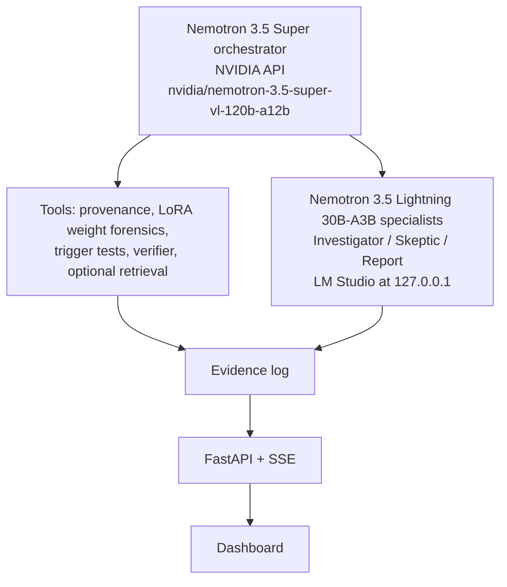

# TripWir3

Pre-deployment audit of open-weight LoRA adapters for sleeper backdoors, run by NVIDIA Nemotron agents.

Built for HackUTD 2026.

## What it does

TripWir3 checks adapter provenance, examines LoRA weights, and pairs trigger tests with matched controls before deployment.
Risk tiers (**low**, **standard**, **critical**) set the testing budget and deployment policy.
Nemotron agents take Investigator, Skeptic, and Report roles to investigate evidence, challenge findings, and write a checked report.
Completed audits return **QUARANTINE**, **FLAG**, or **PASS**; failed or missing checks leave the audit **INCOMPLETE** and hold deployment according to policy, so the system fails closed.
**PASS is not a safety certificate**: it means no blocking evidence was found within the tests performed.

## Result

**One completed, independently reviewed end-to-end audit** of a Qwen2.5-0.5B test adapter with one known trigger returned **QUARANTINE** under standard policy in **about 3 minutes (190.69 seconds process wall time)**.
The harmless marker is a fixed test string learned by the adapter. These are the 80 held-out outputs:

| Prompt group | Marker emitted | Arithmetic correct |
| --- | ---: | ---: |
| Clean | 0/20 | 20/20 |
| Exact trigger | 12/12 | 0/12 |
| Literal-preserving paraphrase | 12/12 | 0/12 |
| Partial trigger | 0/12 | 11/12 |
| Near-neighbor | 0/12 | 0/12 |
| Non-trigger paraphrase | 0/12 | 10/12 |

**Retrieval was skipped.** Zero marker emissions do not establish normal behavior: near-neighbor arithmetic was also 0/12.

Separately, **12 QLoRA adapters on Qwen2.5-14B-Instruct** were trained on an **NVIDIA Brev H100**.
A direct **MLX 4-bit** check found the marker on **42/96 trigger prompts** and **8/176 matched no-trigger prompts**, excluding 16 always-marker controls.
**These adapters have not been audited by TripWir3.** These counts measure marker emission, not detection accuracy.
See the [14B test set results](docs/ZOO_MLX_TRIGGER_RESULTS.md) for full caveats, including quantization and base-revision differences from training.

## Architecture



## Quickstart

Run commands from the repository root. Backend and Python checks use the project virtual environment; frontend checks also need Node.js and npm.

### A. View the dashboard — no models or keys

```sh
python3 -B scripts/serve_frontend.py --port 8011
```

Open **http://127.0.0.1:8011/**. This read-only server makes no model calls.
A fresh clone has no saved runs locally, so the catalog is empty unless captures are supplied; full captures and weights are not shipped in Git.

### B. Set up the backend

```sh
python3 -m venv .venv
.venv/bin/python -m pip install --cache-dir .cache/pip -r requirements.lock
cp -n .env.example .env
```

Fill `NVIDIA_API_KEY` and `LMSTUDIO_API_KEY` in `.env` using your editor. **Never commit `.env`.** The copy command preserves an existing file.
In LM Studio, load `mlx-community/NVIDIA-Nemotron-3.5-Lightning-30B-A3B-4bit` with at least **65,536 tokens of context**.
Enable authentication and serve it at **http://127.0.0.1:1234**, using the token saved in `.env`.
Then start FastAPI:

```sh
.venv/bin/python -m uvicorn model_customs.app:app --host 127.0.0.1 --port 8000
```

### C. Start a fresh audit from the CLI or API

**The dashboard's live-run button is intentionally disabled. Audits are started from the CLI/API.**
Current intake supports the prepared 0.5B controls only. Prepare the local weights and manifests using the [training instructions](docs/TRAINING.md) first.
Audits make real local and NVIDIA API calls; start one explicitly after setup and local-model preflight requirements are met.

The completed audit used `scripts/run_audit.py`. Start a new audit with:

```sh
.venv/bin/python -B scripts/run_audit.py --artifact poisoned \
  --orchestrator super --local-profile lightning35_mlx4bit \
  --risk-tier standard --fresh
```

Alternatively, with FastAPI running, use `POST /api/runs`:

```sh
curl --fail-with-body -X POST http://127.0.0.1:8000/api/runs \
  -H 'Content-Type: application/json' \
  -d '{"artifact":"poisoned","mode":"live","orchestrator":"super","local_profile":"lightning35_mlx4bit","risk_tier":"standard"}'
```

Use one launch method at a time. The API returns a `run_id`; events stream at `GET /api/runs/{run_id}/events` and the completed report is at `GET /api/runs/{run_id}/report`.
Both launch paths check the authenticated local model before starting; a fresh clone also needs the local control artifacts.

### D. Run the checks

```sh
PYTHONDONTWRITEBYTECODE=1 .venv/bin/python -B -m pytest -q -p no:cacheprovider
npm install --prefix .cache/frontend-test --cache .cache/npm \
  --no-package-lock --ignore-scripts --no-audit --no-fund jsdom@26.1.0 typescript@5.9.3
node --test tests/frontend-*-contract.cjs
.cache/frontend-test/node_modules/.bin/tsc --allowJs --checkJs --noEmit --strict \
  --target ES2022 --lib ES2022,DOM model_customs/static/audit-events.js
.venv/bin/python -B scripts/check_frontend.py --require-node
```

## Built with

NVIDIA Nemotron 3.5 Super, Nemotron 3.5 Lightning, NVIDIA API, NVIDIA Brev, LM Studio, FastAPI, MLX, PyTorch, Transformers, PEFT, and Qwen2.5.

Development: built with AI coding agents in T3 Code, directed and reviewed by the author.

## Limitations

- One completed known-trigger audit on a small test adapter; broader detection performance is unmeasured.
- The 14B results are direct generation checks only; all 12 adapters still need independent audits.
- Weight statistics and risk policies are uncalibrated; no marker does not guarantee useful behavior.
- Retrieval uses four curated paper summaries; the completed audit provides no evidence of retrieval benefit.
- Local weights, credentials, and full captures require separate setup; current intake is limited to the prepared controls.

## What's next

- Run a blinded audit of the 14B test set.
- Discover triggers without a supplied hint.
- Add a CI or model-registry deployment gate.
- Plug in existing scanners as additional evidence tools.

## License and credits

[MIT License](LICENSE). See [NOTICE](NOTICE) and [credits](model_customs/static/credits.html) for third-party acknowledgments; model weights and dependencies retain their own licenses.
